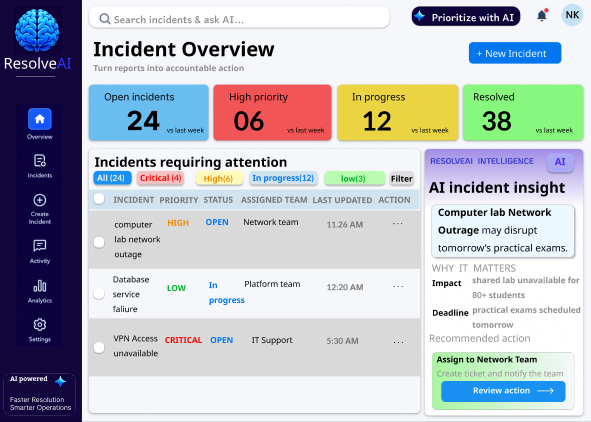
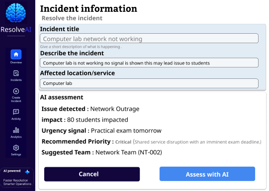
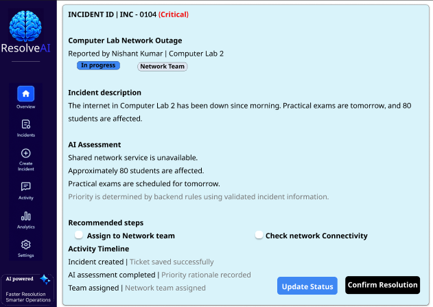

# UI/UX Design
ResolveAI's interface was designed in Figma before implementation, with a focus on clear incident visibility, AI-assisted assessment, and accountable incident handling.

Figma Design: https://www.figma.com/design/WqHiD7hpAnPwTChJzUvnAE/UI-UX-ResolveAI?node-id=0-1&t=gwuITiGlAy6bXFEC-1

# Dashboard 

# Create Incident

# Incident Details

The design covers the core workflow: incident reporting, AI assessment, priority recommendation, team assignment, and resolution tracking.

