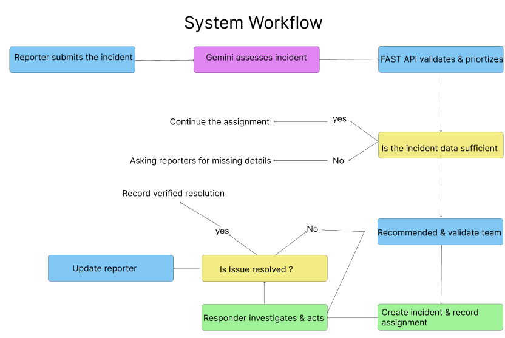

# ResolveAI-System Workflow 
This diagram illustrates how ResolveAI processes an incident from initial reporting to verified resolution.

# Workflow Diagram 

# Workflow Overview
1.Incident Reporting: The reporter submits an incident description and affected location or service.

2.AI Assessment: Gemini extracts the issue, impact, urgency signals, and relevant context.

3.Backend Validation and Prioritization: FastAPI validates the extracted data and applies deterministic priority rules.

4.Assignment Validation: The backend checks team eligibility and authorization before assigning the incident.

5.Incident Persistence: PostgreSQL stores the incident, assignment, status, and relevant audit records.

6.Incident Handling: The assigned responder investigates the issue and records actions taken.

7.Resolution Verification: The incident is marked resolved only after the required confirmation and validation.

8.Reporter Update: The system communicates the latest status and resolution outcome.

# Key Design Principle
Gemini provides incident assessment and recommendations. FastAPI remains responsible for business rules, authorization, action execution, and database changes.